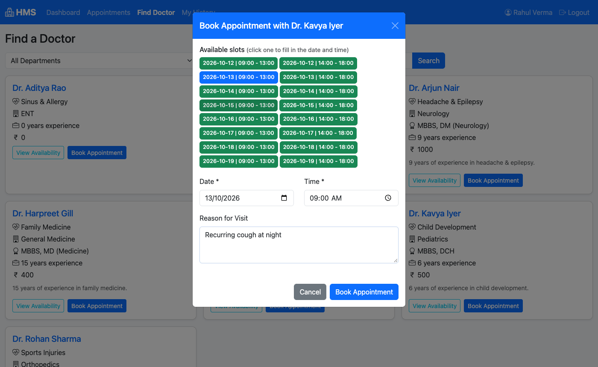
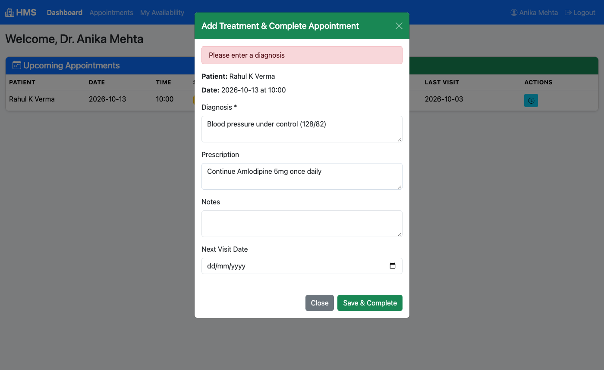
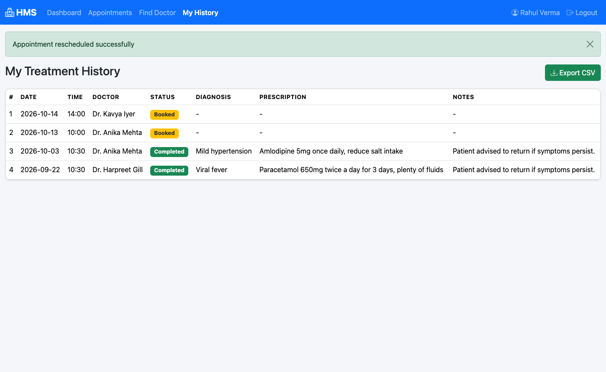
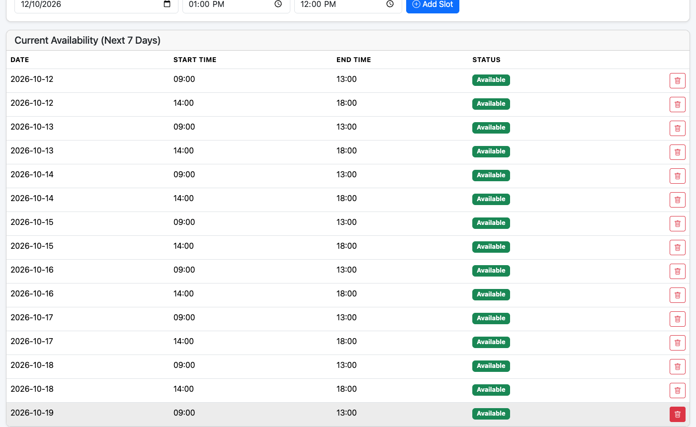
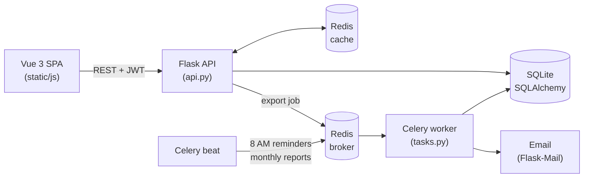

# 🏥 Hospital Management System V2

[](https://github.com/23f2004695/HMSV2/actions/workflows/tests.yml)


A full-stack hospital management app where **admins** manage doctors and patients, **doctors** publish their availability and record treatments, and **patients** find a doctor, book a slot and keep track of their medical history.

This is version 2 of my Hospital Management System. The first version was a classic server-rendered Flask app. V2 rebuilds it as a **single-page app**: a Vue 3 frontend talking to a Flask REST API with JWT auth, Redis caching and Celery jobs for reminders, monthly reports and CSV exports.

<p align="center">
  
</p>

## Features

**Admin**
- Dashboard with live counts of doctors, patients and appointments by status
- Add, edit, deactivate and reactivate doctors
- Search across doctors, patients and departments
- View any patient's full treatment history and deactivate accounts

**Doctor**
- See upcoming appointments and the list of their own patients
- Open availability slots for the next 7 days (patients can only book inside them)
- Complete an appointment by recording diagnosis, prescription, notes and next visit
- Monthly activity report emailed on the 1st of every month

**Patient**
- Register, log in and manage their profile and password
- Browse departments, search doctors and see their open slots
- Book, reschedule and cancel appointments, with clash checks on both sides
- Full treatment history with one-click **CSV export** (runs as a Celery job)
- Morning reminder email on the day of an appointment

## Screenshots

| Admin dashboard | Booking a slot |
|---|---|
|  |  |
| **Doctor dashboard** | **Recording a treatment** |
|  |  |
| **Treatment history + CSV export** | **Doctor availability** |
|  |  |

<details>
<summary>Login and mobile view</summary>

<p>
  
  
</p>
</details>

## Tech stack

| Layer | Tools |
|---|---|
| Frontend | Vue 3 (CDN, no build step), Bootstrap 5, Bootstrap Icons |
| Backend | Flask 3, Flask-SQLAlchemy, Flask-JWT-Extended, Flask-Caching, Flask-Mail |
| Database | SQLite by default (any SQLAlchemy URL works through `DATABASE_URL`) |
| Cache | Redis, with an automatic in-memory fallback when Redis isn't running |
| Background jobs | Celery + Celery Beat with Redis as the broker |
| Tests | pytest (43 tests), run on every push with GitHub Actions |

## How it fits together



## Getting started

You need Python 3.11+. Redis is optional for trying it out.

```bash
git clone https://github.com/23f2004695/HMSV2.git
cd HMSV2
python -m venv venv
source venv/bin/activate          # Windows: venv\Scripts\activate
pip install -r requirements.txt

python seed_demo.py               # optional: demo doctors, patients and appointments
python app.py                     # http://localhost:5000
```

The database and the default admin account are created on first run.

| Account | Username | Password |
|---|---|---|
| Admin | `admin` | `admin123` |
| Doctors (demo data) | `dr.mehta`, `dr.sharma`, `dr.iyer`, `dr.khan`, `dr.gill`, `dr.nair` | `demo123` |
| Patients (demo data) | `rahul`, `sneha`, `amit`, `priya` | `demo123` |

### With Redis and Celery

To get Redis caching and the background jobs, start Redis and run the worker and scheduler in two more terminals:

```bash
redis-server
celery -A celery_worker.celery worker --loglevel=info
celery -A celery_worker.celery beat --loglevel=info
```

If no worker is running, the CSV export still works because the app falls back to exporting directly.

### Configuration

Copy `.env.example` to `.env` to change secrets, the admin password, the database or the Redis URL. To actually send reminder and report emails, set `MAIL_USERNAME` and `MAIL_PASSWORD` (a Gmail app password works). Without them the emails are just logged.

## Running the tests

```bash
pip install -r requirements-dev.txt
pytest
```

The tests cover login and registration, booking rules (availability, double booking, past dates, rescheduling), role permissions for every endpoint, cache invalidation and the background tasks. They use an in-memory database and never touch your real Redis.

## API overview

All routes are under `/api` and, apart from login and register, need an `Authorization: Bearer <token>` header.

| Method | Route | Who |
|---|---|---|
| POST | `/auth/login`, `/auth/register` | anyone |
| GET, PUT | `/auth/me` | logged in (own profile and password) |
| GET | `/departments` | logged in |
| POST | `/departments` | admin |
| GET | `/doctors?search=&department_id=` | logged in |
| POST, PUT, DELETE | `/doctors`, `/doctors/<id>` | admin |
| GET | `/doctors/<id>/availability` | logged in |
| POST, DELETE | `/doctors/<id>/availability[/<slot_id>]` | that doctor or admin |
| GET | `/patients` | admin, or a doctor (only their own patients) |
| GET | `/patients/<id>`, `/patients/<id>/history` | that patient, their doctor, or admin |
| GET, POST | `/appointments` | patients see and book their own, doctors see theirs |
| PUT | `/appointments/<id>`, `/appointments/<id>/cancel` | people involved in the appointment, or admin |
| POST | `/appointments/<id>/treatment` | the appointment's doctor or admin |
| POST | `/patients/<id>/export` | that patient, their doctor, or admin |
| GET | `/tasks/<task_id>`, `/download/<filename>` | whoever is allowed to see that export |
| GET | `/admin/stats`, `/search` | admin |

## Project structure

```
HMSV2/
├── app.py              # app factory, error handlers, first-run seeding
├── api.py              # REST endpoints, validation and permission checks
├── models.py           # SQLAlchemy models
├── config.py           # settings, all overridable from .env
├── extensions.py       # cache, JWT and mail instances
├── exports.py          # CSV export shared by the API and Celery
├── celery_worker.py    # Celery app + beat schedule
├── tasks.py            # reminders, monthly reports, CSV export job
├── seed_demo.py        # demo data
├── templates/index.html
├── static/
│   ├── css/style.css
│   └── js/
│       ├── store.js    # shared state + API helper
│       ├── app.js      # root component and routing
│       └── components/ # dashboards, lists, modals
├── tests/              # pytest suite
└── docs/
    ├── project-report.pdf
    └── screenshots/
```

## Project report

The original write-up for this project is in [`docs/project-report.pdf`](docs/project-report.pdf).
